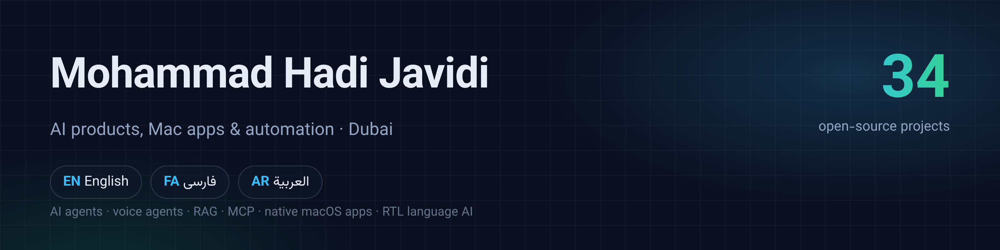

# Mohammad Hadi Javidi (محمد هادی جاویدی)

[Website](https://mohammadhadijavidi.github.io) · [فارسی](https://mohammadhadijavidi.github.io/fa/) · [العربية](https://mohammadhadijavidi.github.io/ar/)

I build AI products and automation from Dubai: voice agents, RAG systems, AI support bots, developer tools and trading analytics. I work in English, Persian (فارسی) and Arabic (العربية), and many of my open-source projects focus on right-to-left languages that mainstream AI tools handle poorly.

Every project below is free and MIT-licensed, ships with tests and CI, and works with OpenAI, Anthropic, OpenRouter, Groq or local models via Ollama.

## Native Mac apps

| App | What it does |
| --- | --- |
| [ModelFit](https://github.com/mohammadhadijavidi/modelfit) | Can your Mac run this AI model? Reads GGUF, safetensors and MLX headers and estimates memory per context length, with Finder Quick Look |
| [Underhood](https://github.com/mohammadhadijavidi/underhood) | Everything running behind the scenes on your Mac, explained in plain English, with signature checks and reversible disable |
| [Harf · حرف](https://github.com/mohammadhadijavidi/harf) | Arabic text toolkit for macOS: Arabizi to Arabic, wrong keyboard layout fix, PDF Arabic repair, in any app |

## AI developer tools

| Project | What it does |
| --- | --- |
| [agent-telegram-remote](https://github.com/mohammadhadijavidi/agent-telegram-remote) | Run and supervise coding agents (Claude Code, Codex CLI, Aider) on your VPS from Telegram, with approval buttons and diffs |
| [mcp-vps-toolkit](https://github.com/mohammadhadijavidi/mcp-vps-toolkit) | Policy-gated MCP server that lets AI assistants operate a Linux server safely |
| [prompt-regression](https://github.com/mohammadhadijavidi/prompt-regression) | Snapshot and regression tests for LLM prompts in CI, with an HTML diff report |
| [llm-cost-meter](https://github.com/mohammadhadijavidi/llm-cost-meter) | Drop-in proxy that meters LLM spend per project and key, with budgets and a dashboard |
| [crash-to-fix](https://github.com/mohammadhadijavidi/crash-to-fix) | iOS and Android crash logs to root cause, source line and a checked patch |
| [jarvis-hud](https://github.com/mohammadhadijavidi/jarvis-hud) | Cinematic browser HUD for voice AI assistants, works with any realtime backend |

## AI agents for business

| Project | What it does |
| --- | --- |
| [voice-agent-starter](https://github.com/mohammadhadijavidi/voice-agent-starter) | Production-ready AI phone agent template: Twilio, STT, LLM, TTS, barge-in and tools |
| [ai-support-inbox](https://github.com/mohammadhadijavidi/ai-support-inbox) | AI support agent and team inbox for Telegram, WhatsApp and Instagram DMs |
| [shorts-forge](https://github.com/mohammadhadijavidi/shorts-forge) | Turn long videos into ranked vertical shorts with AI highlights and captions |
| [mt5-ai-analyst](https://github.com/mohammadhadijavidi/mt5-ai-analyst) | AI trade analyst for MetaTrader 5 history and backtest reports |

## Persian AI · هوش مصنوعی فارسی

| Project | What it does |
| --- | --- |
| [rag-farsi](https://github.com/mohammadhadijavidi/rag-farsi) | چت با اسناد فارسی (PDF، Word): RAG با جست‌وجوی ترکیبی و ارجاع به منبع |
| [zirnevis-ai](https://github.com/mohammadhadijavidi/zirnevis-ai) | زیرنویس خودکار فارسی با Whisper و سوزاندن درست راست‌به‌چپ |
| [tarjome-srt](https://github.com/mohammadhadijavidi/tarjome-srt) | ترجمه‌ی هوشمند زیرنویس به فارسی با حفظ دقیق تایمینگ |
| [prompts-fa](https://github.com/mohammadhadijavidi/prompts-fa) | کتابخانه‌ی پرامپت فارسی برای کسب‌وکار، با [سایت جست‌وجوپذیر](https://mohammadhadijavidi.github.io/prompts-fa/) |
| [support-userbot-fa](https://github.com/mohammadhadijavidi/support-userbot-fa) | دستیار پشتیبانی فارسی برای تلگرام که از فایل دانش جواب می‌ده |
| [voice-note-bot-fa](https://github.com/mohammadhadijavidi/voice-note-bot-fa) | ربات تلگرام: تبدیل ویس فارسی به متن، خلاصه و لیست کارها |
| [call-agent-fa](https://github.com/mohammadhadijavidi/call-agent-fa) | ایجنت تلفنی فارسی‌زبان برای نوبت‌دهی و سفارش |
| [trade-journal-fa](https://github.com/mohammadhadijavidi/trade-journal-fa) | ژورنال ترید فارسی با بازبینی هوش مصنوعی و تاریخ شمسی |
| [ocr-fa](https://github.com/mohammadhadijavidi/ocr-fa) | استخراج فاکتور و رسید فارسی به JSON با مدل‌های بینایی |
| [fa-llm-eval](https://github.com/mohammadhadijavidi/fa-llm-eval) | بنچمارک باز مدل‌های زبانی روی تسک‌های فارسی |

## Arabic AI · الذكاء الاصطناعي بالعربية

| Project | What it does |
| --- | --- |
| [arabic-rag](https://github.com/mohammadhadijavidi/arabic-rag) | منصة RAG عربية تفهم الهمزات واللهجة الخليجية مع استشهاد بالمصادر |
| [whatsapp-agent-ar](https://github.com/mohammadhadijavidi/whatsapp-agent-ar) | وكيل ذكاء اصطناعي عربي على واجهة WhatsApp Cloud الرسمية للمشاريع في الإمارات |
| [gulf-dialect-translator](https://github.com/mohammadhadijavidi/gulf-dialect-translator) | مترجم اللهجة الإماراتية والخليجية ↔ الفصحى ↔ الإنجليزية |
| [uae-vat-invoice-ai](https://github.com/mohammadhadijavidi/uae-vat-invoice-ai) | استخراج الفواتير والتحقق من ضريبة القيمة المضافة 5% والرقم الضريبي |
| [arabic-subtitle-ai](https://github.com/mohammadhadijavidi/arabic-subtitle-ai) | تفريغ وترجمة تلقائية للفيديو العربي مع حرق صحيح من اليمين لليسار |
| [ar-llm-eval](https://github.com/mohammadhadijavidi/ar-llm-eval) | معيار مفتوح لتقييم النماذج اللغوية بالعربية واللهجة الخليجية |
| [arabic-content-studio](https://github.com/mohammadhadijavidi/arabic-content-studio) | استوديو محتوى عربي للسوشيال ميديا مع تقويم المناسبات الإماراتية |
| [listing-writer-ae](https://github.com/mohammadhadijavidi/listing-writer-ae) | كاتب إعلانات عقارية ثنائي اللغة لدبي بالذكاء الاصطناعي |
| [voice-agent-ar](https://github.com/mohammadhadijavidi/voice-agent-ar) | وكيل صوتي عربي لحجز المطاعم والعيادات يفهم اللهجة الخليجية |
| [cv-tailor-gcc](https://github.com/mohammadhadijavidi/cv-tailor-gcc) | تكييف السيرة الذاتية مع إعلانات الوظائف في الخليج دون اختلاق خبرات |

## Building blocks

- [rtl-burn](https://github.com/mohammadhadijavidi/rtl-burn): burn Persian, Arabic, Urdu and Hebrew subtitles into video with ffmpeg without broken punctuation. Used by several projects above.

## Stack

Python, TypeScript, Swift, SwiftUI · FastAPI, aiogram, Telethon · OpenAI, Anthropic, Ollama, Whisper · Twilio, WhatsApp Cloud API, Telegram Bot API · ffmpeg, Playwright · Linux, Docker, VPS infrastructure · iOS (shipped Technicalist, an AI trading analysis app)

## Contact

Open an issue on any repository, or reach out for AI product, agent and automation work in the UAE and the region.
